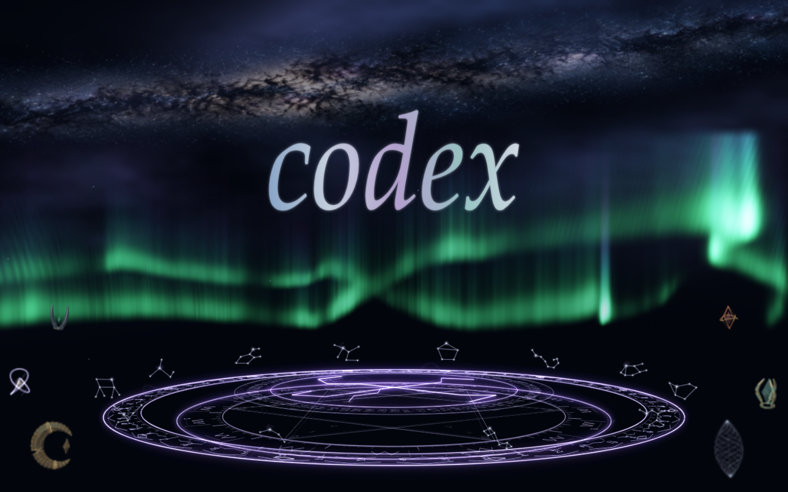

# Codex Magic Launcher 1.0

Windows 上的银河、极光与白金法阵启动器，为 Codex Desktop 与已配置的 Dream Skin 提供启动过渡。



这是独立的非官方项目，与 OpenAI 无隶属关系。

## 下载与使用

1. 从 [v1.0.0 Releases](https://github.com/whx666hhh/CodexMagicLauncher/releases/tag/v1.0.0) 下载 `CodexMagicLauncher-1.0.0-win-x64.zip`。
2. 解压到具有写入权限的目录，保留全部文件，双击 `CodexMagicDesktop.exe`。
3. 可选：在解压目录运行 `powershell -NoProfile -ExecutionPolicy Bypass -File install-desktop-shortcut.ps1`，建立桌面快捷方式。

需要 Windows x64、官方 Codex Desktop，以及已安装并配置好的 [Codex Dream Skin](https://github.com/Fei-Away/Codex-Dream-Skin)。本版本对接已安装的 Dream Skin 1.5.20；皮肤引擎、主题和 Codex 本体不在下载包内。首次使用前请先确认自己的 Dream Skin 能正常启动。

点击后先出现启动反馈，再逐步展开桌面吞噬、银河、极光、法阵、六件悬浮法器和 codex 字样。正常完整流程约 50 秒；后台尚未就绪时，等待阶段继续运动。供能线在字样写完后消退。按 **Esc** 可取消并恢复桌面状态。若皮肤流程要求重启 Codex，请阅读它显示的原生确认提示，先保存未发送的输入。

## 从源码构建

准备 Node.js 22.12 或更高版本、npm，以及 Windows 自带的 .NET Framework C# 编译器。在项目根目录执行：

```powershell
npm ci
npm run build
powershell -NoProfile -ExecutionPolicy Bypass -File test-desktop.ps1
powershell -NoProfile -ExecutionPolicy Bypass -File build-release.ps1
```

便携包输出到 `dist/`，附带 SHA-256 校验文件。`scripts/release-files.json` 明确列出发布文件；日志、运行状态、旧草稿和个人主题不参与打包。

## 验证范围

自动回归覆盖时钟、窗口恢复、延迟就绪、取消和点击反馈；桌面测试使用合成目标。已测机器的合成流程约 29.7 fps，不能代表所有显卡或多屏环境。当前视觉版本尚未重新完成一次真实冷启动的“首帧已带皮肤”验收。详细范围见 [QA.md](QA.md)。

## 许可

项目自有代码使用 [MIT](LICENSE)。Electron、GSAP 和字体相关素材保留各自许可，见 [第三方声明](THIRD_PARTY_NOTICES.md)。Codex 名称及相关商标归各自权利人所有。
